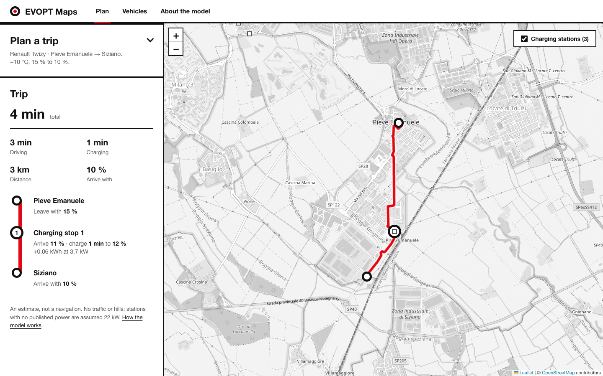

# EVOPT Maps

Plan the fastest route for an electric car, with charging stops only where the battery needs them.




EVOPT Maps downloads real roads and real charging stations, estimates how much energy each road segment costs for a chosen vehicle and temperature, and searches for the trip that arrives fastest, charging as little as possible. The result is shown on a map and as a trip line where every charging stop prints its minutes, energy and the battery level before and after.

It started as a university project for the Intelligent Systems course and has been rewritten as a small, tested web app. The original A\* and desktop GUI version lives in the [`legacy`](../../tree/legacy) branch.

## Features

- Real road network from OpenStreetMap, kept directed so one-way streets are respected.
- Real charging stations from OpenStreetMap, completed with power data from Open Charge Map when an API key is set.
- Physical energy model: rolling resistance, air drag, drivetrain efficiency and temperature-dependent climate load.
- Time-optimal planning over battery state, so charging stops appear only when and where they pay off.
- Web interface with live progress, clear errors, a vehicle roster and an explanation of the model.
- Expiring disk cache, so a city is downloaded once (roads for 30 days, stations for 7).

## Getting started

You need [uv](https://docs.astral.sh/uv/) and Python 3.13 or newer.

```bash
git clone https://github.com/PasticciniTeams/EVOPT-Maps.git
cd EVOPT-Maps
uv sync
uv run uvicorn evopt.api:app
```

Open <http://127.0.0.1:8000>. The form is pre-filled with a small example that needs a charging stop.

> [!NOTE]
> The first plan for a new area downloads its roads and takes from a few seconds to a few minutes. After that it is instant. The public Overpass server can refuse large areas: use a city, not a region.

### Open Charge Map (optional)

Open Charge Map fills in the power of stations that OpenStreetMap does not describe. Get a free key from [openchargemap.org](https://openchargemap.org) (My Profile, My Apps) and put it in a `.env` file:

```bash
echo 'OCM_API_KEY=your_key' > .env
uv run --env-file .env uvicorn evopt.api:app
```

Without a key only OpenStreetMap is used, and stations with unknown power are assumed to be 22 kW.

## Use it as a library

```python
from evopt.data import load_network
from evopt.graph import nearest_node
from evopt.planner import Planner
from evopt.vehicle import VEHICLES

G = load_network("Pieve Emanuele, Italy")  # roads + charging stations
start = nearest_node(G, 45.35, 9.17)
goal = nearest_node(G, 45.33, 9.15)

planner = Planner(G, VEHICLES["Renault Twizy"], temp_c=-10)  # reuse it: station legs are computed once
route = planner.plan(start, goal, start_soc=0.15, min_soc=0.10, algorithm="astar")
print(route.time_s / 60, "min,", len(route.charges), "charging stop(s),", route.stats["expanded"], "states")
```

## How it works

1. **Energy per segment.** For each road segment the model adds rolling resistance and air drag at the segment speed, divided by drivetrain efficiency, plus the power of heating or cooling over the time spent on it:

   ```text
   energy = (Crr·m·g + ½·ρ·CdA·v²) · distance / efficiency + aux(temperature) · time
   ```

2. **Reduced graph.** Dijkstra on travel time from the start and from every station keeps only the legs the battery can cover. The legs between stations are computed once per vehicle and temperature and reused by every later plan. This leaves a small graph of start, goal and stations.
3. **Search over battery state.** A state is `(node, charge level)` with the charge in 1% steps. Driving spends levels, charging at a station adds one level at the lower of the vehicle's and the station's power, and the trip never goes below the chosen arrival charge. The goal is any state at the destination.

Plain shortest-path search is not enough here: battery is a constrained resource, so the best route depends on where you charge and how much. That is why the search runs over `(node, charge)` and not over nodes.

## Algorithms

The same problem is solved by several algorithms, selectable under **Advanced** in the web app. Tick **Compare all algorithms** to run all of them on your trip and see the differences on the **Algorithms** page.

| Algorithm | Guarantee | Idea |
| --- | --- | --- |
| Dijkstra | optimal | expands states by cost only |
| A\* | optimal | adds the straight-line travel time to the goal as a heuristic |
| A\*, energy-aware | optimal | heuristic also counts a lower bound on the charging time still needed |
| A\*, exact potentials | optimal | heuristic from two backward searches: true minimum drive time and minimum energy to the goal |
| Weighted A\* (w=2) | at most 2x optimal | inflates the heuristic: far fewer states |
| ARA\* | anytime, ends optimal | answers fast with a large weight, then improves it reusing earlier work, with a proven bound at each step |
| Naive driver | none | goes to the charger nearest the destination and charges to 80% each time |
| Exact reference | optimal at 1% charge steps | label search on the full road network, no reduced graph |

The road-level search (Dijkstra, A\*, Weighted A\*, ARA\* between two nodes) is in `evopt/search.py`. Its default heuristic is straight-line distance over the best straight-line speed of any road, admissible and consistent by construction; optional ALT landmarks tighten it. The state search also prunes dominated states, a state being useless if another at the same place has more charge and no higher cost.

Legs between chargers can use the single fastest road (default) or **Pareto labels** (time, energy), which keep slower but more efficient roads that the fastest-road shortcut would miss.

### Measured results

Everything below is regenerated by `uv run python -m benchmarks.compare` (synthetic grids) and `... --local milano-torino` (real roads, see [Realistic test](#realistic-test)). One laptop core, pure Python.

**Real trip: Milano Duomo to Torino Porta Nuova** (47,068 nodes, 86,195 edges, 506 charger nodes). Renault Twingo Electric (22 kWh), 0 °C, from 90% to at least 10%.

Road-level search between the two points:

| Algorithm | Trip (min) | States | ms |
| --- | --- | --- | --- |
| Dijkstra | 80.84 | 40,202 | 106 |
| A\*, straight line | 80.84 | 17,580 | 120 |
| A\* + ALT (8 landmarks) | 80.84 | 4,824 | 31 |
| Weighted A\* (w=2) | 95.92 (+18.7%) | 5,024 | 15 |
| ARA\*, first answer (w=3) | 95.92 (+18.7%) | 632 | |
| ARA\*, final | 80.84 | 18,013 | 57 |

ALT needs 1.8 s of preprocessing, once per graph.

Electric trip, with charging:

| Algorithm | Trip (min) | Stops | States | Search (ms) |
| --- | --- | --- | --- | --- |
| Dijkstra | 110.84 | 3 | 15,213 | |
| A\*, straight line | 110.84 | 3 | 9,657 | 681 |
| A\*, energy-aware | 110.84 | 3 | 8,703 | 828 |
| **A\*, exact potentials** | 110.84 | 3 | **2,873** | **237** |
| Weighted A\* (w=2) | 125.05 (+12.8%) | 6 | 53 | 5 |
| ARA\* | 110.84 | 2 | 6,756 | 490 |
| Naive driver | 144.65 (+30.5%) | 1 | 2 | 243 |

The first plan is slower because it computes the legs between the stations the search reaches: 18 s and 168 road searches with the best heuristic. Computing the legs for all 506 stations took 54 s, and Dijkstra, which reaches most of them, spent about 31 s on the rest.

**Synthetic grid, 60x60** (3,600 nodes, 80 stations, trip needing four stops): Dijkstra 6,790 states, A\* 6,698, A\* with exact potentials 2,539, Weighted A\* 238 states but 7.9% slower, naive driver 2.3% slower, exact reference 299,645 states and 12 to 60 times slower than the reduced graph for a result within 0.2%.

What the numbers say:

- **On real roads the heuristic matters a lot.** At road level ALT expands 8 times fewer states than Dijkstra and 3.6 times fewer than straight-line A\*, because real roads are far from straight. On the electric problem the exact backward potentials cut the states by 81% against Dijkstra.
- **Search is not the main cost.** What dominates is running road searches for the legs between chargers (about 0.1 s each in Python). Computing them lazily, only for stations the search expands, and caching them is the biggest saving. A\* with a strong heuristic wins mostly because it needs fewer of them.
- **Weighted A\* and ARA\* are fast but crude here.** Weight 2 saves nearly all the search and loses 13% on the real trip, with six stops instead of three. ARA\*'s answers sit at +18% (weight 3) and +8% (weight 1.5) before reaching the optimum, so its guarantee is useful but its early answers are not close to optimal on this problem.
- **The naive driver loses 30% on the real trip**, charging to 80% at the charger nearest the destination each time, and 2 to 9% on the grids.
- **The reduced graph agrees with the exact reference** to within 0.2% on the grids.
- **Pareto legs cost 7 to 8 times more** to build and gave the same trip on the grids.
- **The energy-aware heuristic that only uses a per-metre energy bound is barely better than plain A\*** (8,703 against 9,657 states); the backward potentials, which use the real minimum energy to the goal, are what pays.

## Realistic test

Big areas fail on the public Overpass server, so the real trip above uses a local OpenStreetMap extract.

```bash
mkdir -p data
curl -L -o data/nord-ovest.osm.pbf https://download.geofabrik.de/europe/italy/nord-ovest-latest.osm.pbf   # 593 MB
uv run --group extract python -m benchmarks.extract data/nord-ovest.osm.pbf --bbox 7.4 44.9 9.5 45.7 --name milano-torino
uv run python -m benchmarks.compare --local milano-torino
```

The extraction keeps motorways, trunk, primary and secondary roads, contracts nodes that are not junctions, and reads charging stations from the same file. The `data/` folder is not tracked by git.

## Project structure

| Path | Purpose |
| --- | --- |
| `evopt/vehicle.py` | Vehicle data and the energy model |
| `evopt/graph.py` | Road graph loading, nearest node, route geometry |
| `evopt/stations.py` | Stations from OpenStreetMap and Open Charge Map, merging, snapping to the graph |
| `evopt/search.py` | Dijkstra, A*, Weighted A*, ARA* on a generic implicit graph |
| `evopt/planner.py` | The `Planner`: energy legs, state graph, all algorithms, naive and exact baselines |
| `evopt/router.py` | `Route`, `NoRouteError` and the one-call `plan_route` |
| `benchmarks/compare.py`, `benchmarks/extract.py` | Algorithm comparison; extraction of roads and stations from a local OSM file |
| `evopt/cache.py`, `evopt/data.py` | Expiring disk cache and one-call network loading |
| `evopt/api.py` | FastAPI app: planning jobs, vehicles, static frontend |
| `web/` | Static frontend (HTML, CSS, JS, Leaflet), no build step |
| `tests/` | pytest suite |
| `PRODUCT.md`, `DESIGN.md` | Product context and design system of the web interface |

The API is small: `GET /api/vehicles`, `GET /api/algorithms`, `POST /api/plan` (returns a job id; accepts `algorithm`, `legs`, `compare`) and `GET /api/jobs/{id}` (status, stage, result or error).

## Development

```bash
uv run pytest        # tests
uv run ruff check .  # lint
uv run ruff format . # format
```

The tests replace only the network boundaries (Overpass, Open Charge Map, geocoding), so the routing, cache and API logic run for real.

## Limitations

> [!IMPORTANT]
> This is an estimate, not a navigation system.

- No traffic, road works, elevation or braking energy recovery.
- No live charger availability.
- Charging is modelled at constant power, so long stops are slightly optimistic.
- Vehicle parameters are approximate values from public data sheets.
- With the default `fastest` legs the energy of a leg is that of the fastest road, not the most efficient one (`pareto` removes this).
- The efficient-frontier and exact searches are slow on big areas; the comparison skips the exact reference above 2,500 nodes.

## Credits

Map data © [OpenStreetMap](https://www.openstreetmap.org/copyright) contributors. Station data from [Open Charge Map](https://openchargemap.org). Maps drawn with [Leaflet](https://leafletjs.com).

By Filippo Camossi and Daniele Cioli. The original course presentation is in [`example/`](example/).
