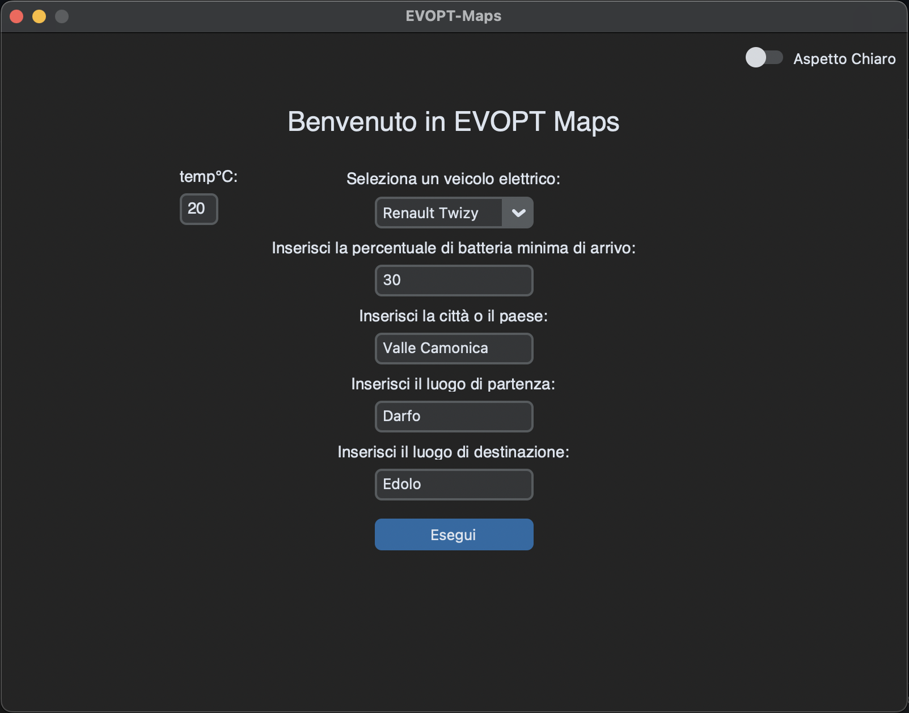
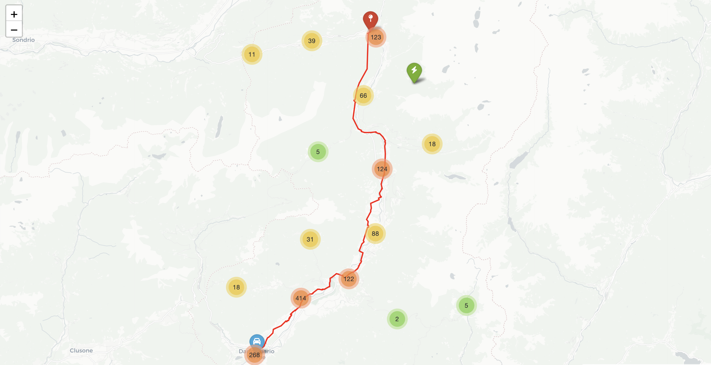

# EVOPT Maps (legacy version)

> [!NOTE]
> This branch keeps the original course project as it was handed in. The maintained version, a rewrite as a tested web app, is on [`main`](https://github.com/SickCiQuattro/EVOPT-Maps).

EVOPT Maps was a university assignment for the Intelligent Systems course at the University of Brescia. It loads real roads with [osmnx](https://osmnx.readthedocs.io), finds charging stations and uses an A\* search to plan the trip of an electric vehicle, with a desktop interface to choose the route and the arrival charge.




## Run it

```bash
git clone --branch legacy https://github.com/SickCiQuattro/EVOPT-Maps.git
cd EVOPT-Maps
pip3 install folium osmnx numpy geopy scikit-learn customtkinter
python3 gui.py
```

The code is in `ASTAR.py`, `search_algorithm.py`, `search_problem.py`, `heuristics.py`, `electric_vehicle.py` and `path_finding.py`. The Sphinx sources of the documentation are in `docs/`, and the course presentation is in `example/`.

## Authors

- [Filippo Camossi](https://github.com/SickCiQuattro)
- [Daniele Cioli](https://github.com/Profect99)

The early version of the search algorithm is kept under the tag `old-algorithm`.
