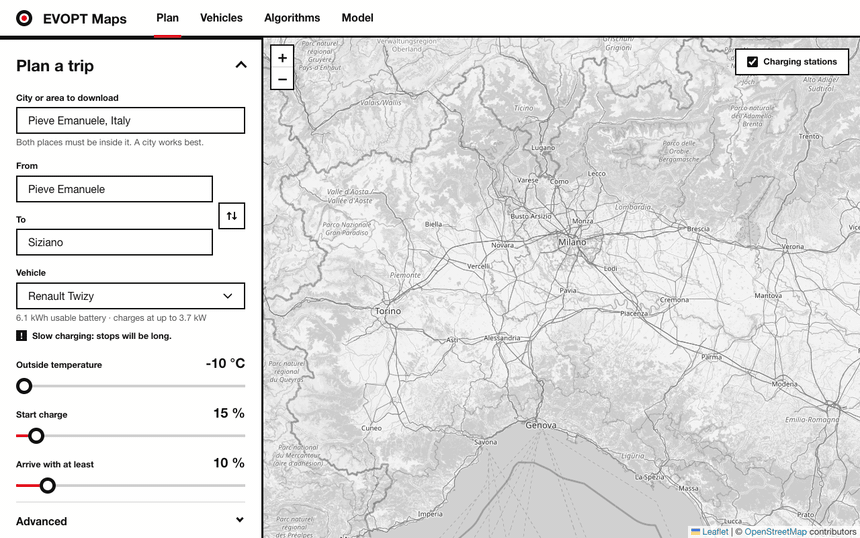
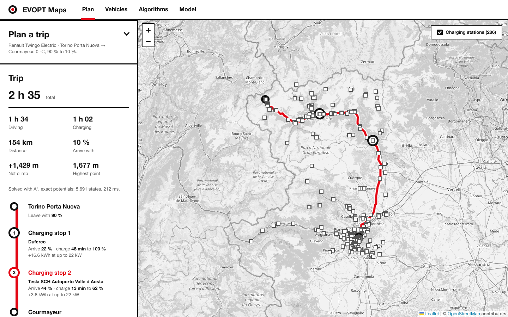
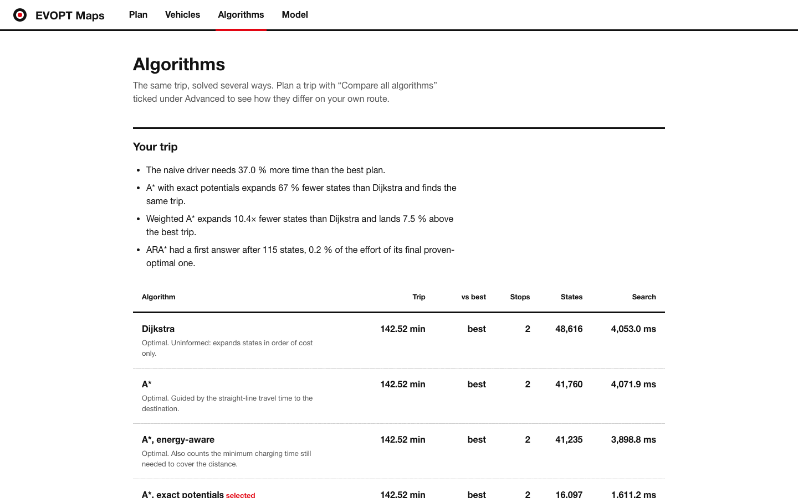

# EVOPT Maps

Plan the fastest route for an electric car, with charging stops only where the battery needs them.

[](https://github.com/SickCiQuattro/EVOPT-Maps/actions/workflows/ci.yml)




EVOPT Maps loads real roads, real chargers and terrain, estimates how much energy each road segment costs for a chosen vehicle and temperature, and searches for the trip that arrives fastest. The route is shown on a map and as a trip line in which every charging stop prints its minutes, its energy and the battery before and after. Eight search algorithms solve the same problem and can be compared on your own trip.

It started as a university project for the Intelligent Systems course and was rewritten as a small, tested web app. The original A\* and desktop GUI version lives in the [`legacy`](https://github.com/SickCiQuattro/EVOPT-Maps/tree/legacy) branch.

<table>
  <tr>
    <td width="33%"></td>
    <td width="33%"></td>
    <td width="33%"></td>
  </tr>
  <tr>
    <td align="center">Milano to Torino, 145 km</td>
    <td align="center">Torino to Courmayeur, +1,429 m</td>
    <td align="center">Algorithm comparison</td>
  </tr>
</table>

## At a glance

Measured on a real 145 km trip with 859 chargers (details in [docs/RESULTS.md](docs/RESULTS.md)):

- **Calibrated on public figures.** The first energy model overstated range at 110 km/h by 18 to 37%. After calibrating on EV Database figures it matches them, and it predicts a held-out point (urban consumption in the cold) within 4%. The calibration turned a one-stop plan into a two-stop one ([docs/MODEL.md](docs/MODEL.md)).
- **A\* with exact potentials expands 67% fewer states than Dijkstra** on the real trip, and 8 times fewer with ALT landmarks at road level. The planner gets the same optimal trip.
- **A naive "charge to 80% at the nearest charger" driver needs 37% more time** than the planned trip.
- **A 1,000 m climb costs 18% more energy**, and elevation changes the plan: the same trip goes from one stop to two.
- **Planning a 145 km trip takes about 4.5 s** once the legs between chargers are cached, and about 9 s after a restart.

## Features

- Real directed road network from OpenStreetMap, so one-way streets are respected.
- Real charging stations with operator and name, from OpenStreetMap and completed with power data from Open Charge Map when a key is set.
- Physical energy model for five vehicles: rolling resistance, air drag, a cold penalty per kilometre, urban stop-and-go, climbs and descents from terrain data. Four vehicles are calibrated on public figures.
- Charging that slows down above 80% on fast chargers, and a fixed plug-in time per stop.
- Optimal planning over battery state, with Dijkstra, A\*, A\* with exact potentials, Weighted A\*, ARA\*, a naive driver and an exact reference.
- Web interface with live progress, clear errors, a vehicle roster and an algorithm comparison page.
- Expiring disk cache for roads and stations, and a saved table of the legs between chargers.

## Getting started

You need [uv](https://docs.astral.sh/uv/) and Python 3.13 or newer.

```bash
git clone https://github.com/SickCiQuattro/EVOPT-Maps.git
cd EVOPT-Maps
uv sync
uv run uvicorn evopt.api:app
```

Open <http://127.0.0.1:8000>. The form is pre-filled with a small example that needs a charging stop.

> [!NOTE]
> The first plan for a new area downloads its roads and can take a few minutes; after that it is instant. The public Overpass server may refuse large areas, so use a city rather than a region, or a local extract (see [Realistic test](#realistic-test)).

### Open Charge Map (optional)

Open Charge Map fills in the power of stations that OpenStreetMap does not describe. Get a free key from [openchargemap.org](https://openchargemap.org) (My Profile, My Apps) and put it in a `.env` file:

```bash
echo 'OCM_API_KEY=your_key' > .env
uv run --env-file .env uvicorn evopt.api:app
```

Without a key only OpenStreetMap is used, and stations with unknown power are estimated from their sockets or assumed to be 22 kW.

## Use it as a library

```python
from evopt.data import load_network
from evopt.graph import nearest_node
from evopt.planner import Planner
from evopt.vehicle import VEHICLES

G = load_network("Pieve Emanuele, Italy")  # roads, chargers and elevations
start = nearest_node(G, 45.35, 9.17)
goal = nearest_node(G, 45.33, 9.15)

planner = Planner(G, VEHICLES["Renault Twizy"], temp_c=-10, plug_in_s=180)  # reuse it: legs are cached
route = planner.plan(start, goal, start_soc=0.15, min_soc=0.10, algorithm="astar_potential")
print(route.time_s / 60, "min,", len(route.charges), "stop(s),", route.stats["expanded"], "states")
```

## How it works

1. **Energy per segment.** Rolling resistance, air drag, climb, a cold penalty and stop-and-go, from a model calibrated on public consumption figures ([docs/MODEL.md](docs/MODEL.md)).
2. **Reduced graph.** Dijkstra on travel time from the start, towards the goal and between chargers keeps only the legs the battery can cover. The legs between chargers are computed lazily, only for chargers the search reaches, and saved on disk.
3. **Search over battery state.** A state is `(node, charge level, charging)` with the charge in 1% steps. Driving spends levels, charging adds one at a power that depends on the charge, a plug-in time is paid once per stop, and the trip never goes below the chosen arrival charge. The goal is any state at the destination.

Plain shortest-path search is not enough: the battery is a constrained resource, so the best route depends on where you charge and how much. That is why the search runs over `(node, charge)` and not over nodes.

### Algorithms

Pick one under **Advanced** in the web app, or tick **Compare all algorithms** to run them all on your trip.

| Algorithm | Guarantee | Idea |
| --- | --- | --- |
| Dijkstra | optimal | expands states by cost only |
| A\* | optimal | adds the straight-line travel time to the goal as a heuristic |
| A\*, energy-aware | optimal | also counts a lower bound on the charging time still needed |
| A\*, exact potentials | optimal | heuristic from two backward searches: true minimum drive time and energy to the goal |
| Weighted A\* (w=1.5) | at most 1.5x optimal | inflates the heuristic: fewer states, often a slower trip |
| ARA\* | anytime, ends optimal | answers fast with a large weight, then improves it reusing earlier work, with a proven bound at each step |
| Naive driver | none | goes to the nearest decent charger to the goal and charges to 80% each time |
| Exact reference | optimal at 1% charge steps | label search on the full road network, with no reduced graph |

Road-level search between two nodes (Dijkstra, A\*, Weighted A\*, ARA\*, ALT landmarks) is in `evopt/search.py`. The state search prunes dominated states: a state is useless if another at the same place has more charge and no higher cost.

## Realistic test

Large areas fail on the public Overpass server, so the real trips in [docs/RESULTS.md](docs/RESULTS.md) use a local OpenStreetMap extract.

```bash
mkdir -p data
curl -L -o data/nord-ovest.osm.pbf https://download.geofabrik.de/europe/italy/nord-ovest-latest.osm.pbf   # 593 MB
uv run --group extract python -m benchmarks.extract data/nord-ovest.osm.pbf --bbox 7.4 44.9 9.5 45.7 --name milano-torino
uv run python -m benchmarks.compare --local milano-torino
```

Select the extract in the web app with the area name `local:milano-torino`. The extraction keeps motorways, trunk, primary and secondary roads, contracts nodes that are not junctions, and reads chargers with name, operator and power from the same file. The `data/` folder is not tracked by git. A mountain trip uses the same command with `--bbox 6.8 44.95 7.9 45.9 --name torino-courmayeur` (its results are in [docs/MODEL.md](docs/MODEL.md#elevation)).

## Project structure

| Path | Purpose |
| --- | --- |
| `evopt/vehicle.py` | Vehicle data and the energy model |
| `evopt/graph.py` | Road graph loading, nearest node, route geometry |
| `evopt/elevation.py` | Terrain tiles, bilinear sampling, smoothing, node elevations |
| `evopt/stations.py` | Chargers from OpenStreetMap and Open Charge Map, merging, snapping to the graph |
| `evopt/search.py` | Dijkstra, A\*, Weighted A\*, ARA\* and ALT on a generic implicit graph |
| `evopt/planner.py` | The `Planner`: legs, state graph, all algorithms, naive and exact baselines |
| `evopt/router.py` | `Route`, `NoRouteError` and the one-call `plan_route` |
| `evopt/cache.py`, `evopt/data.py` | Expiring disk cache and one-call network loading |
| `evopt/api.py` | FastAPI app: planning jobs, comparison, vehicles, static frontend |
| `web/` | Static frontend (HTML, CSS, JS, Leaflet), no build step |
| `benchmarks/` | `compare` (algorithms), `calibrate` (vehicles), `extract` (local OSM extracts) |
| `tests/` | pytest suite |
| `docs/` | Measured results, energy model and calibration |
| `PRODUCT.md`, `DESIGN.md` | Product context and design system of the web interface |

The API is small: `GET /api/vehicles`, `GET /api/algorithms`, `POST /api/plan` (returns a job id; accepts `algorithm`, `legs`, `compare`, `elevation`) and `GET /api/jobs/{id}` (status, stage, result or error, and the comparison once ready).

## Development

```bash
uv run pytest        # tests
uv run ruff check .  # lint
uv run ruff format . # format
```

The tests replace only the network boundaries (Overpass, Open Charge Map, geocoding, terrain tiles), so routing, cache and API logic run for real.

## Limitations

> [!IMPORTANT]
> This is an estimate, not a navigation system.

- No traffic or road works, and no live charger availability or access rules: a car may be sent to a charger its network does not allow.
- Elevation is approximate (30 m terrain data, smoothed), and descents are prudent: they save energy but never charge the battery.
- Vehicle consumption is calibrated on EV Database estimates for four of five vehicles; the Twizy is approximate, hot-weather consumption is not calibrated, and plans run at the speed limit.
- Charging uses a simple taper curve; real curves depend on temperature and battery state.
- Charger power is often missing in OpenStreetMap (217 of 1,400 on the corridor): it is estimated, completed from Open Charge Map, or assumed to be 22 kW.
- With the default `fastest` legs, the energy of a leg is that of the fastest road, not the most efficient one (`pareto` removes this).

See [docs/MODEL.md](docs/MODEL.md) for how far each approximation can be trusted.

## Credits

Map data © [OpenStreetMap](https://www.openstreetmap.org/copyright) contributors. Charger data from [Open Charge Map](https://openchargemap.org). Vehicle reference figures from [EV Database](https://ev-database.org). Elevation from terrain tiles on [AWS Open Data](https://registry.opendata.aws/terrain-tiles/) (Mapzen, SRTM and other sources). Maps drawn with [Leaflet](https://leafletjs.com).

By Filippo Camossi and Daniele Cioli. The original course presentation is in [`example/`](example/).
